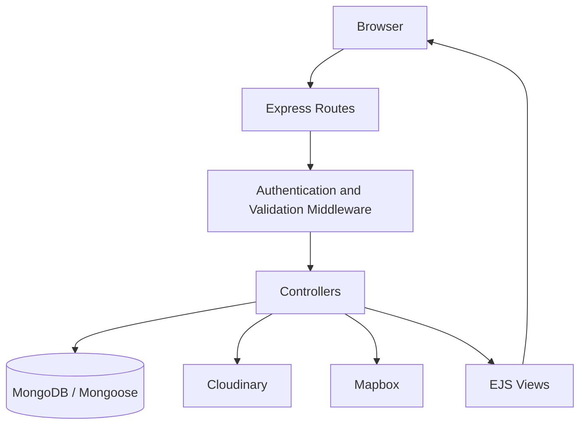

<div align="center">

# WanderLust

### Discover places. Share stays. Explore the world.

**A full-stack vacation rental listing platform inspired by Airbnb, built with Node.js, Express, MongoDB, and EJS.**

[**🌐 Live Demo**](https://wanderlust-9sjd.onrender.com) · [**💻 Source Code**](https://github.com/urvija-kapila/WanderLust)

    

</div>

---

## Overview

**WanderLust** is a responsive, full-stack web application where users can discover vacation properties, explore stays by category or keyword, and share their own listings. Registered users can create and manage listings, upload property images, and post ratings and reviews. Each property also includes an interactive location map.

The project demonstrates end-to-end development across **server-side rendering, RESTful routing, authentication and authorization, database modeling, file uploads, third-party API integration, validation, and cloud deployment**.

> **Live application:** https://wanderlust-9sjd.onrender.com  
> Note: On a free hosting tier, the first request may take longer if the service has been idle.

## Main Features

### Discover & explore

- Browse property listings with images, descriptions, nightly prices, and locations.
- **Keyword search** across listing titles, descriptions, locations, and countries, with partial and case-insensitive matching.
- **Category-based filtering** for property types such as Beaches, Mountains, Camping, Castles, Farms, and more.
- Combine category filtering with keyword search.
- Navigate categories using a **horizontally scrollable filter bar** with arrow controls.
- Toggle the display of tax information alongside listing prices.
- Responsive layout across desktop, tablet, and mobile screens.

### Listing management

- Create, view, edit, and delete property listings.
- Upload listing images using **Multer and Cloudinary**.
- Choose and update a category for a property.
- Restrict listing updates and deletion to the listing owner.

###  Accounts & community

- Register, log in, and log out using **Passport.js** and **passport-local-mongoose**.
- Maintain login sessions using **express-session** with MongoDB-backed session storage.
- Write star ratings and reviews for properties.
- Restrict review deletion to its author.
- View helpful success and error messages through flash notifications.

###  Location & reliability

- Display property locations on interactive maps using **Mapbox**.
- Validate incoming listing and review data with **Joi**.
- Handle asynchronous route errors through centralized Express error middleware.
- Delete associated reviews when a listing is removed.

##  Tech Stack

| Layer | Technologies |
| --- | --- |
| **Frontend** | HTML, CSS, JavaScript, Bootstrap, EJS, EJS-Mate |
| **Backend** | Node.js, Express.js |
| **Database** | MongoDB, Mongoose |
| **Authentication** | Passport.js, passport-local, passport-local-mongoose |
| **Sessions** | express-session, connect-mongo |
| **Image uploads** | Multer, Cloudinary |
| **Maps & geocoding** | Mapbox |
| **Validation & middleware** | Joi, method-override, connect-flash |
| **Deployment** | Render |

## Architecture

The app follows a **Model–View–Controller (MVC)** structure to separate routing, business logic, data models, and presentation.



### Project structure

```text
WanderLust/
├── app.js                  # Express app and middleware setup
├── cloudConfig.js          # Cloudinary upload configuration
├── controllers/
│   ├── listings.js         # Listing operations, search and filtering
│   ├── reviews.js          # Review operations
│   └── users.js            # Authentication flows
├── models/
│   ├── listing.js          # Listing schema and relationships
│   ├── review.js           # Ratings and reviews
│   └── user.js             # User accounts
├── routes/
│   ├── listing.js
│   ├── review.js
│   └── user.js
├── views/
│   ├── includes/           # Shared navbar, footer, messages
│   ├── layouts/            # Main EJS layout
│   ├── listings/           # Explore, show, new, edit
│   └── users/              # Login and signup
├── public/
│   ├── css/
│   └── js/
├── middleware.js           # Auth, ownership and validation
├── schema.js               # Joi validation schemas
├── utils/                  # Error and async helpers
├── package.json
└── README.md
```

The application also includes an `init/` directory for development data setup. A shared category configuration file may be present in newer versions of the project.

## Set Up

### Prerequisites

- **Node.js** and npm (use the Node version specified in `package.json` when possible)
- A **MongoDB Atlas** connection string or accessible MongoDB database
- A **Cloudinary** account for image uploads
- A **Mapbox** access token for maps and geocoding

### 1. Clone the repository

```bash
git clone https://github.com/urvija-kapila/WanderLust.git
cd WanderLust
```

### 2. Install dependencies

```bash
npm install
```

### 3. Configure environment variables

Create a `.env` file in the project root:

```dotenv
NODE_ENV=development
ATLASDB_URL=your_mongodb_connection_string
CLOUD_NAME=your_cloudinary_cloud_name
CLOUD_API_KEY=your_cloudinary_api_key
CLOUD_API_SECRET=your_cloudinary_api_secret
MAP_TOKEN=your_mapbox_access_token
SECRET=your_secure_session_secret
```

> The session-secret variable name should match the current version of your `app.js`. Do **not** commit `.env`, API credentials, or database connection strings to Git.

### 4. Start the application

```bash
node app.js
```

For automatic restarts during development, you can use `npx nodemon app.js` if nodemon is installed or available.

Open **http://localhost:8080/listings** in your browser (or **http://localhost:8080/** if the root redirect is enabled).

##  Engineering Highlights

**Search & filtering:** Uses query parameters and server-side MongoDB queries to retrieve matching listings without filtering only in the browser. The search supports partial, case-insensitive matches across multiple listing fields.

**Authorization:** Uses route-level middleware to check authentication and resource ownership before restricted actions, such as editing or deleting a listing or review.

**Data relationships:** Models relationships between users, property listings, and reviews using Mongoose references, including cleanup of associated reviews on listing deletion.

**Media management:** Processes user-uploaded images through Multer and stores them in Cloudinary, rather than keeping image files in the app's local filesystem.

**Responsive UI:** Uses Bootstrap's responsive grid alongside custom CSS for listing cards, forms, navigation, filters, and detail pages.

## Key Routes

| Method | Route | Description |
| --- | --- | --- |
| `GET` | `/listings` | Browse, search, and filter listings |
| `GET` | `/listings/new` | Show create-listing form |
| `POST` | `/listings` | Create a listing (authenticated) |
| `GET` | `/listings/:id` | View a listing, reviews, and map |
| `GET` | `/listings/:id/edit` | Show edit form (owner) |
| `PUT` | `/listings/:id` | Update a listing (owner) |
| `DELETE` | `/listings/:id` | Delete a listing (owner) |
| `POST` | `/listings/:id/reviews` | Create a review (authenticated) |
| `DELETE` | `/listings/:id/reviews/:reviewId` | Delete a review (author) |
| `GET`, `POST` | `/signup` | Register an account |
| `GET`, `POST` | `/login` | Sign in |
| `GET` | `/logout` | Log out |


##  Security Notes

- Store secrets and credentials in environment variables, **never** in source control.
- Protect state-changing routes with authentication and authorization middleware.
- Validate user-submitted data on the server.
- Use HTTPS and secure session-cookie configuration in production.

## Project Status

**Deployed and functional.** The project is built as a learning and portfolio application inspired by vacation rental platforms; it is **not affiliated with Airbnb** and does not implement real bookings or payment processing.

## Author

**Urvija Kapila**  
GitHub: [@urvija-kapila](https://github.com/urvija-kapila)

---

